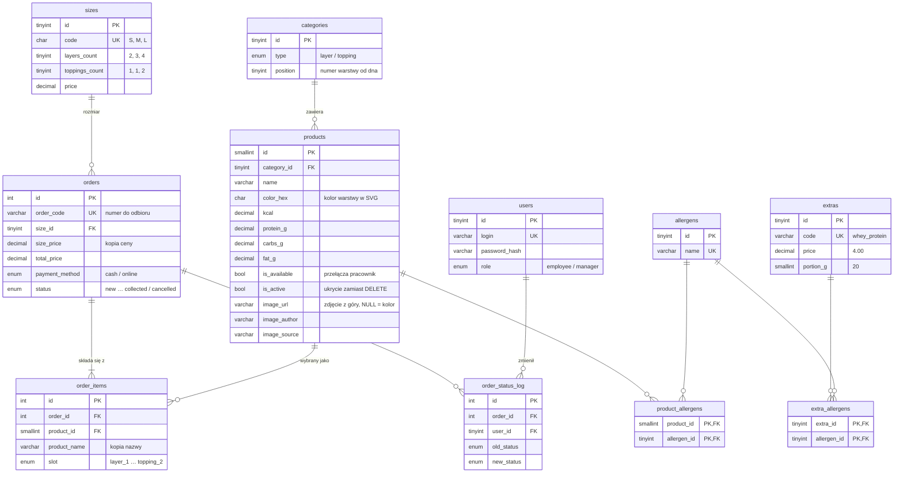

# Baza danych – diagram ERD (zadanie 11, BE)

GitHub sam rysuje poniższy diagram. Pełna definicja: `database/schema.sql`.

## Najważniejsze decyzje

- **Kopie cen i nazw w zamówieniu** (`size_price`, `product_name`) – zmiana cennika
  lub nazwy produktu nie zmienia historii ani podsumowania sprzedaży.
- **Brak fizycznego usuwania produktów** – `is_available` (pracownik, chwilowy brak)
  i `is_active` (kierownik, wycofanie na stałe). `ON DELETE RESTRICT` na produktach
  użytych w zamówieniach dodatkowo blokuje przypadkowe `DELETE`.
- **`UNIQUE(order_id, product_id)`** – składnik nie może się powtórzyć w jednym kubku,
  co przy okazji wymusza dwa *różne* toppingi w rozmiarze L.
- **Zdjęcia składników** (`image_url`, `image_author`, `image_source` w `products` i `extras`)
  – adres zdjęcia z Unsplash / Pexels albo ścieżka do własnego pliku w `public/`. Konfigurator
  wypełnia nim warstwę kubka; gdy `image_url` jest puste, zostaje `color_hex`. Dodane migracją
  `database/migrations/001_zdjecia_skladnikow.sql`.
- **`extra_allergens`** – tabela dodana względem planu, bo białko serwatkowe zawiera
  mleko i ten alergen musi trafić do podsumowania.
